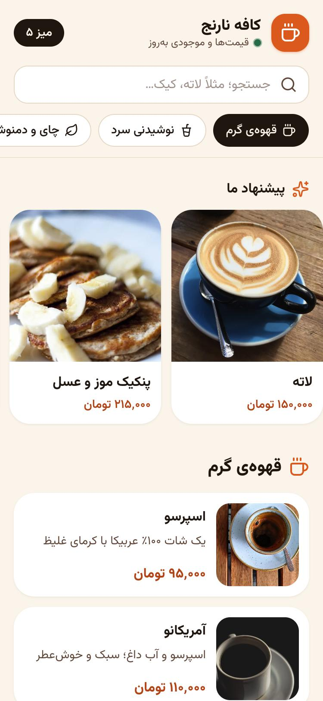
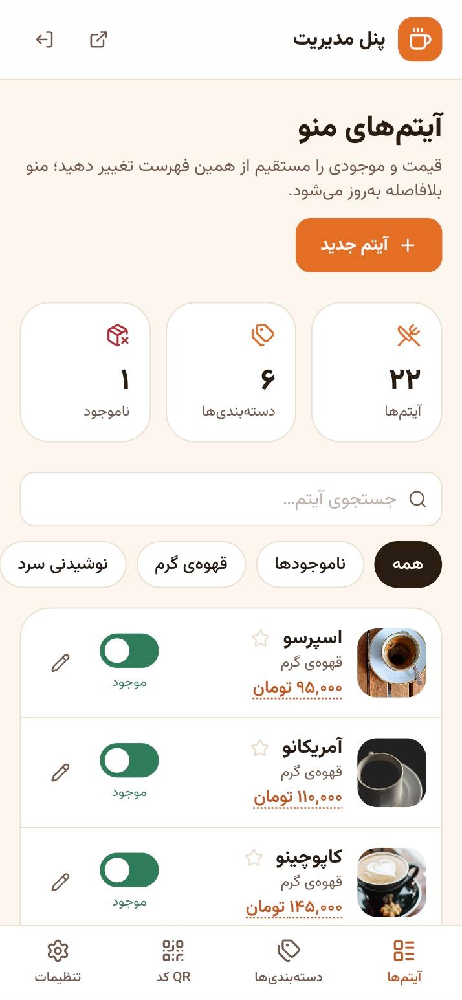
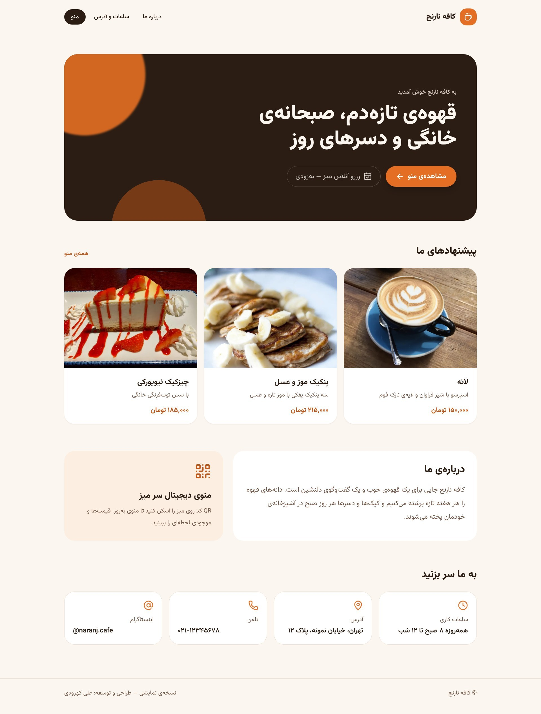

# کافه نارنج — منوی دیجیتال QR و پنل مدیریت

پلتفرم ماژولار برای کافه و رستوران: منوی دیجیتال با QR کد، به‌روزرسانی لحظه‌ای قیمت و موجودی، و پنل مدیریت فارسی که روی موبایل هم راحت کار می‌کند.

> A modular café platform: QR digital menu with live price/stock updates and a mobile-friendly Persian admin panel.
> **Stack:** Next.js 16 (App Router) · Node.js + Express 5 · Prisma · SQLite/MySQL/PostgreSQL · Tailwind CSS 4

| منو روی گوشی | پنل مدیریت | صفحه‌ی اصلی |
|---|---|---|
|  |  |  |

## امکانات

**منوی مشتری** (`/menu`)
- طراحی موبایل‌محور، راست‌چین و فونت وزیرمتن (بدون وابستگی به سرویس‌های خارجی)
- دسته‌بندی‌های چسبان با پیمایش خودکار، جستجوی فارسی (حساس نبودن به ی/ي و نیم‌فاصله)
- بخش «پیشنهاد ما»، نمایش «ناموجود» برای آیتم‌های تمام‌شده
- **به‌روزرسانی زنده**: هر تغییری در پنل، بدون رفرش روی گوشی مشتری اعمال می‌شود (Server-Sent Events)
- پشتیبانی از شماره‌ی میز: `/menu?table=5` (پایه‌ی فاز سفارش سر میز)

**پنل مدیریت** (`/admin`)
- ورود امن (رمز هش‌شده با bcrypt، کوکی httpOnly، محدودیت تلاش ورود)
- تغییر قیمت و موجودی با یک لمس از همان فهرست آیتم‌ها
- افزودن/ویرایش آیتم با آپلود عکس از گوشی؛ عکس خودکار به WebP فشرده می‌شود
- مدیریت و مرتب‌سازی دسته‌بندی‌ها، انتخاب آیکون
- ساخت و چاپ کارت QR برای هر میز
- ویرایش اطلاعات کافه (ساعات کاری، آدرس، تلفن، …)

**صفحه‌ی معرفی کافه** (`/`) با پیشنهادهای ویژه، درباره‌ی ما و اطلاعات تماس.

## اجرا روی سیستم

پیش‌نیاز: Node.js نسخه‌ی ۲۰ یا بالاتر

```bash
cp api/.env.example api/.env   # سپس JWT_SECRET و ADMIN_PASSWORD را عوض کنید
npm run setup                  # نصب پکیج‌ها + ساخت دیتابیس + داده‌ی نمونه
npm run dev                    # API روی پورت 4000 و سایت روی پورت 3000
```

- سایت: http://localhost:3000
- منو: http://localhost:3000/menu
- پنل مدیریت: http://localhost:3000/admin (نام کاربری و رمز در `api/.env`)

برای تغییر رمز پنل: مقدار `ADMIN_PASSWORD` را در `api/.env` عوض کنید و `npm run admin:password -w api` را اجرا کنید (منو دست نمی‌خورد).

برای بازگشت به داده‌ی نمونه (همراه با عکس‌ها): `npm run db:reset -w api`
عکس‌های نمونه در `api/prisma/demo-images` هستند (CC0 / مالکیت عمومی؛ منابع در `CREDITS.md` همان پوشه).

## ساختار پروژه

```
api/                 Express + Prisma (REST API، احراز هویت، آپلود، رویدادهای زنده)
  prisma/schema.prisma   مدل داده‌ها
  prisma/seed.js         داده‌ی نمونه‌ی منو
  src/routes/            menu, items, categories, cafe, auth, uploads
web/                 Next.js (صفحه‌ی اصلی، منو، پنل مدیریت)
  app/menu/              منوی مشتری
  app/admin/             پنل مدیریت
```

## انتشار روی هاست ایرانی

پروژه هیچ وابستگی به سرویس خارجی ندارد و روی هر سرویس ابری ایرانی که Node.js پشتیبانی کند (مثل لیارا، هم‌روش، ابرآروان) اجرا می‌شود.

1. **دیتابیس:** در `api/prisma/schema.prisma` مقدار `provider` را به `mysql` یا `postgresql` تغییر دهید و `DATABASE_URL` را تنظیم کنید.
2. **API:** متغیرهای `api/.env.example` را تنظیم و `NODE_ENV=production` قرار دهید؛ پوشه‌ی `api/uploads` باید روی دیسک ماندگار باشد.
3. **سایت:** قبل از `npm run build` متغیر `API_URL` را روی آدرس API بگذارید.
4. اگر پشت Nginx هستید، بافر را برای مسیر `/api/menu/stream` خاموش کنید (هدر `X-Accel-Buffering` از قبل ارسال می‌شود).

## فازهای بعدی (طراحی ماژولار)

- **فاز ۲:** باشگاه مشتریان با ورود پیامکی، امتیاز و کد تخفیف؛ رزرو آنلاین میز؛ مدیریت رویدادها
- **فاز ۳:** سفارش سر میز از گوشی مشتری و نمایش زنده در پنل آشپزخانه و صندوق (زیرساخت شماره‌ی میز و رویدادهای زنده آماده است)

---

طراحی و توسعه: علی کهرودی
